<p align="center">
  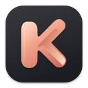
</p>

<h1 align="center">Klay</h1>

<p align="center">Fast digital sculpting with a ZBrush-style workspace. Written in Rust.</p>

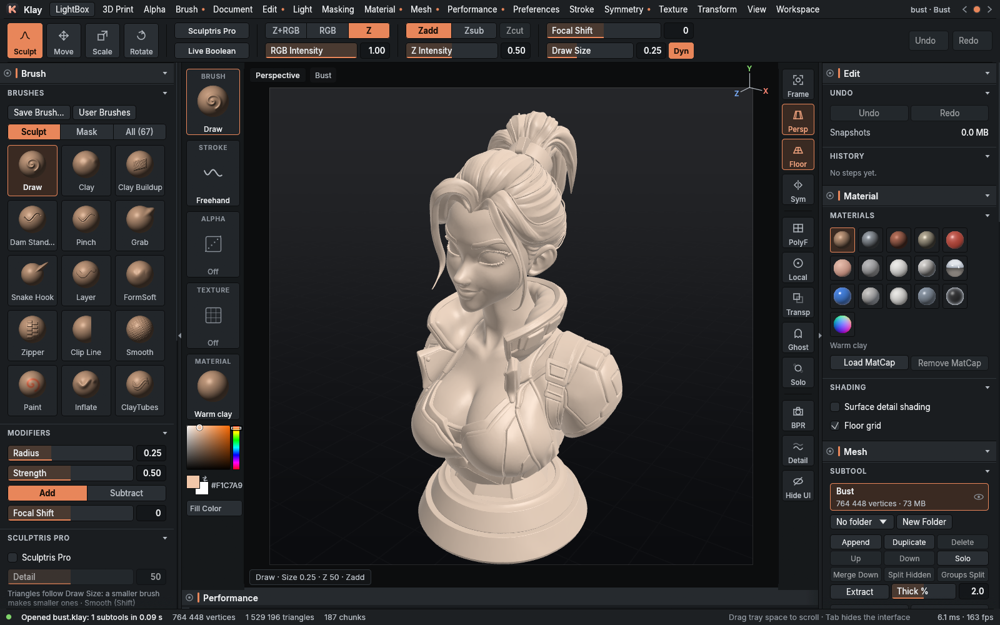

## Highlights

- **Millions of polygons**, subdivision levels and layers, on any Vulkan GPU
- **67 brushes**: Clay, Dam Standard, Move, Snake Hook, hPolish, Trim, Slash, Noise and more, picked ZBrush-style with **B** and two letters
- **LightBox**: browse local projects, tools, brushes, materials, alphas, textures and QuickSaves with **,** (comma)
- **Custom brush presets** save the live brush setup and embed imported alphas and textures. Load them after restarting from **LightBox › User › Brushes**.
- **Model import** supports OBJ, STL, GLB, glTF, FBX and ZBrush GoZ. Multipart scenes open as editable SubTools.
- **OBJ round trips** preserve faces, UVs and named groups. Update a SubTool’s cage from OBJ and carry its sculpted detail forward.
- **Subdivision and layers** with Catmull–Clark on quad cages, geometry and UV smoothing controls, and layers that record shape, paint and masks.
- **UV editing and map export** with manual seams, checker previews, island editing, vector displacement and batch baking across visible SubTools.
- **Retopology**: **ZRemesher** with undoable guide curves, polypaint density, X/Y/Z mirror planes, KeepCreases, Detect Edges and FreezeBorder; **ProjectAll** to bring the sculpt's detail onto the new mesh; **Reconstruct Subdiv** and **Freeze SubDiv Levels**
- **Geometry**: **ZSpheres** (with cube nodes), **Dynamic Subdivision**, **Panel Loops**, **Sculptris Pro**, **Live Boolean**, **Decimation**, **UV Master**, **normal, displacement and colour map baking**, **ZModeler**, creases that Divide keeps sharp, Remesh, Insert Mesh and CurveTube
- **Render** with shadows and ambient occlusion, **Turntable** videos, **Spotlight**, **FiberMesh** and cloth **Dynamics**
- **Select, Clip, Trim, Slice and Knife** tools, masking, polygroups and **polypaint** with brush alphas and textures in RGB and Z+RGB, including live DragRect and DragDot stamp previews
- **Your workspace**: dock any palette, drag any shelf item anywhere, themes, UI scale, stored configs
- **Pen pressure** on Linux tablets, symmetry (mirror and radial), MatCaps

| | |
|---|---|
| 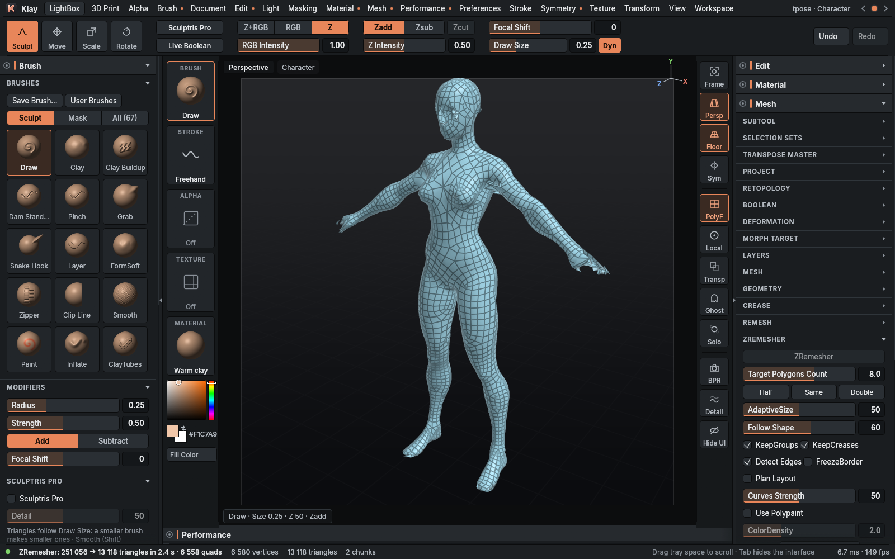 | 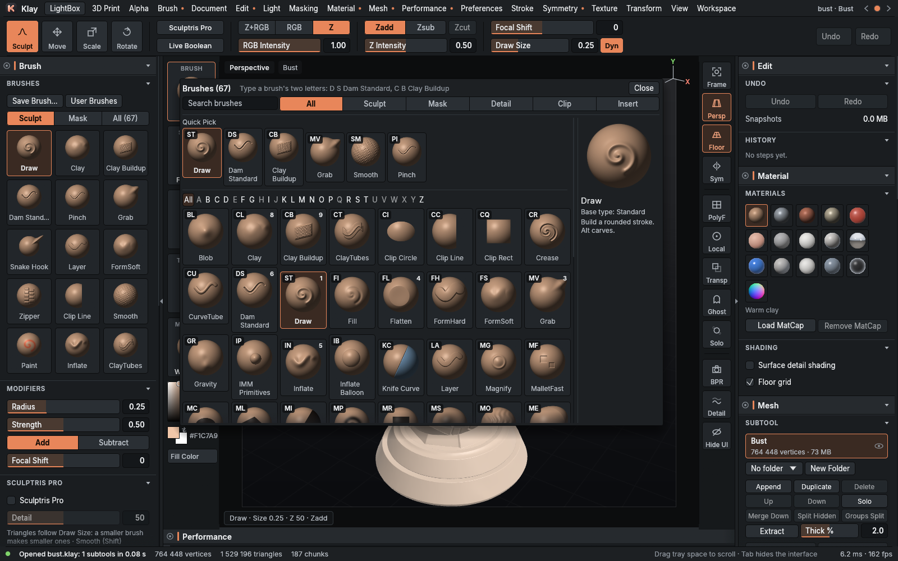 |
| ZRemesher: clean quads that follow the form | The brush catalog, ZBrush key codes on every tile |
| 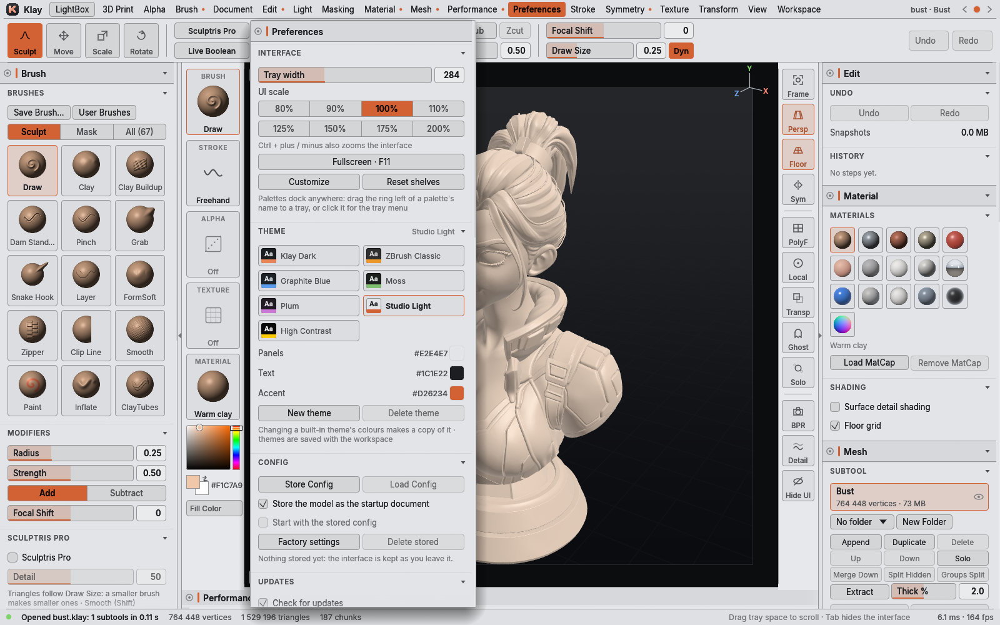 | 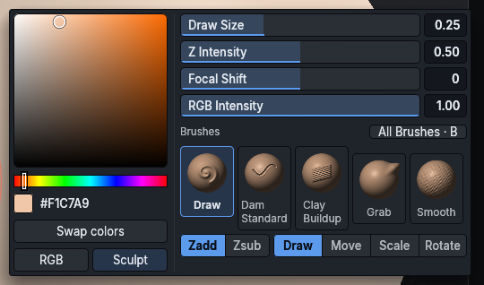 |
| Themes, UI scale and Customize in Preferences | Space menu for polypaint color, brush settings and brush selection |

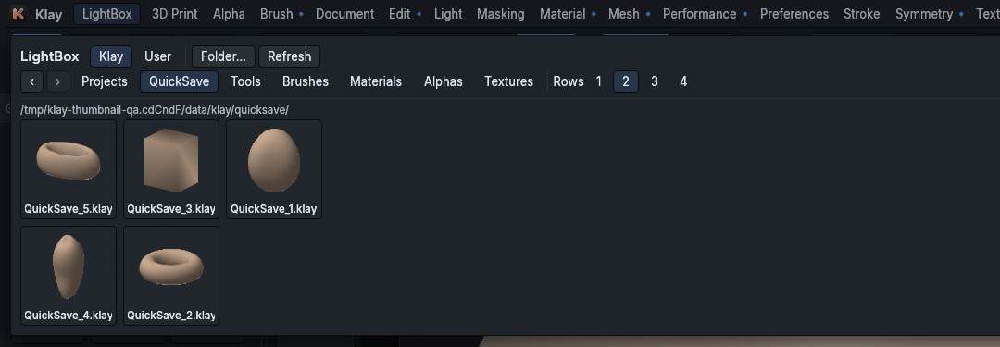

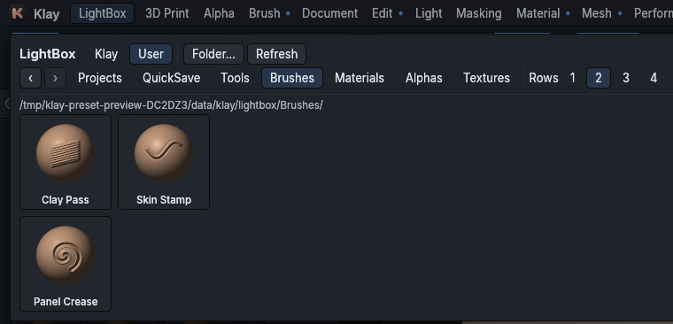

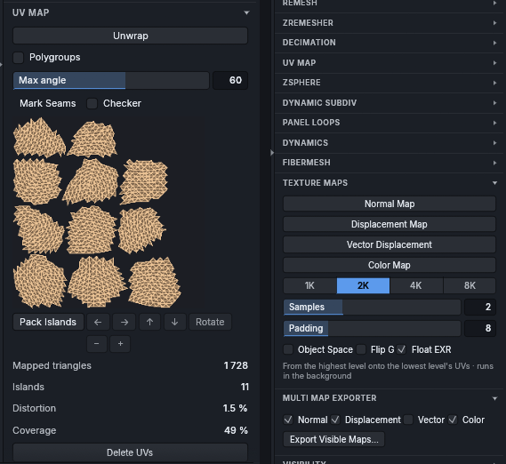

## Install

Download the latest release from the [releases page](https://github.com/ozzy-apps/klay/releases):

| Format | Install |
|---|---|
| `.deb` (Ubuntu, Debian, Mint, Zorin) | `sudo apt install ./klay_<version>_amd64.deb` |
| Flatpak | `flatpak install --user Klay-<version>-x86_64.flatpak` |
| AppImage | `chmod +x Klay-<version>-x86_64.AppImage` and run it |

The 0.46.0 Debian package and AppImage require glibc 2.39 or later. Klay checks for new releases while it runs (Preferences › Updates).

### Build from source

```bash
cargo run --release
```

Needs Rust, a C compiler for the FBX parser, and a Vulkan driver. `scripts/` builds the .deb, Flatpak and AppImage.

## Getting around

| | |
|---|---|
| Drag on the model | sculpt (Alt: the other way, Shift: smooth) |
| Drag on the canvas | rotate · Alt: move · Alt then release: zoom |
| Ctrl + drag | mask · Ctrl + Shift: hide, clip, trim, slice |
| B, two letters | pick a brush (B D S: Dam Standard) |
| Brush › Save Brush… | save the current setup to LightBox › User › Brushes |
| `,` | toggle LightBox. Double-click a thumbnail to load it |
| Space | brush menu at the cursor |
| Q W E R | sculpt, move, scale, rotate |
| F · Tab · F11 | frame the model · hide the interface · fullscreen |

The full manual is in [docs/guide.md](docs/guide.md), and what changed in each version is in [CHANGELOG.md](CHANGELOG.md).

## Model import and SubTools

- Use **Document › Import › Import Models…** or double-click a model in **LightBox › User › Tools**. **Fit** centers and scales each file as a whole. Keep external glTF geometry buffers with the model.
- For a ZBrush ZTool (`.ztl`), open it in ZBrush and export FBX, OBJ or GoZ. Klay imports the sculptable mesh data.
- In **Mesh › Deformation**, choose **X**, **Y** or **Z** under **Mirror Axis**. **Mirror Copy** puts a reflected mesh below the source. **SubTool › Merge Down** joins them into one SubTool. **Mirror And Weld** builds a symmetric mesh with a welded seam.
- Double-click a SubTool row to rename it. Click **Fill Color** below the color picker or in the **Space** menu to apply the picked color to visible, unmasked areas of the active SubTool.

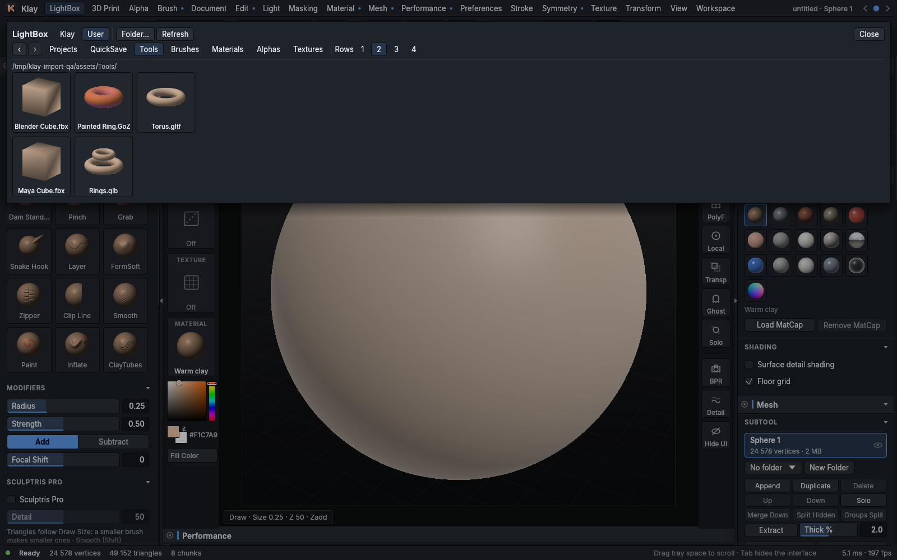

## ZRemesher guides and symmetry

- **Ctrl + Z** undoes a guide stroke. With **ZRemesherGuide** selected (**B Z G**), **Alt + click** a line to remove it. **Delete guides** clears the active SubTool's guides in one undo step.
- In **Mesh › ZRemesher**, set **Symmetry** to **Force X**, **Force Y** or **Force Z**. Enable **SubTool Center** for an off-center mesh. ZRemesher mirrors the positive half and welds the seam where it meets the plane.

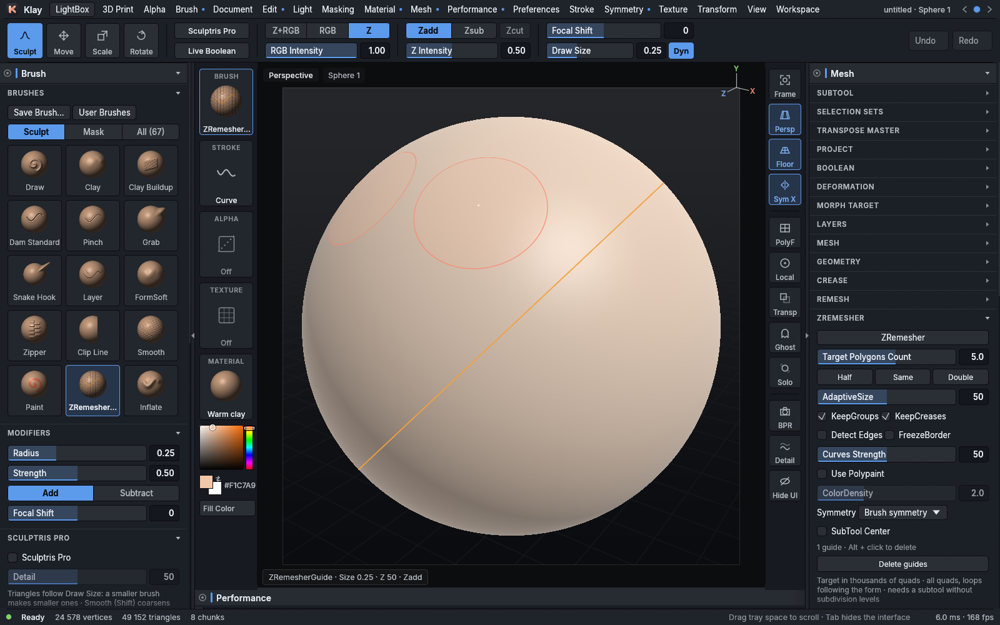

## Clip brushes

- Keep the mouse or pen down and hold **Space** to move a Clip Line, Clip Rect or Clip Circle guide. Release Space to resume drawing, then release the mouse or pen to apply.
- Clip Rect uses the cut's cross-section on closed meshes so geometry pressed to the rectangle edge stays within the surface there.

## Contact

Found a bug, or have a request? [Open an issue](https://github.com/ozzy-apps/klay/issues) or write to [klay@ozzy.co.nl](mailto:klay@ozzy.co.nl).

Made with love by Ozzy ♥ · [MIT License](LICENSE)


### Strata direct transfer (local source build)

Built only with `cargo build --release --features strata`; default builds and the release packages leave it out. With the sibling Strata project available, `../Strata/run-klay.sh` builds both and starts Klay with it. Under **3D Print > Strata**, use **Send to Strata** to transfer the active subtool (or check Visible subtools for an assembly), then **Update in Strata** after sculpting. Updates keep Studio position, rotation, scale and print settings. The first transfer uses the physical scale in 3D Print > Size; linked transfers retain it. Use the actual shown subdivision level and materialize Live Boolean results before sending.

Links currently last for a Klay document session; reopening requires Send again. No .klay format change was made. Dense meshes above the current 500,000 vertex/triangle bridge limit need a lower shown level. Existing running binaries must be reopened to show the actions. See `../Strata/handoff.md` for the protocol, verification and remaining work.
