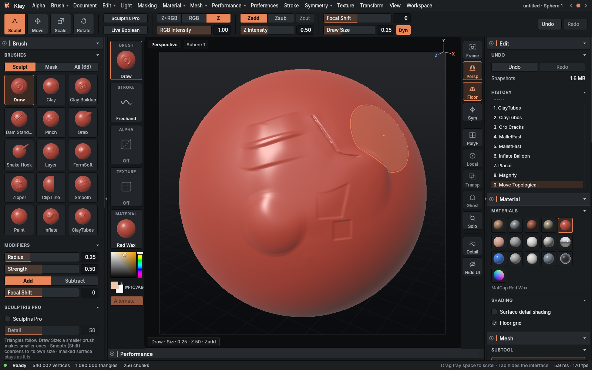
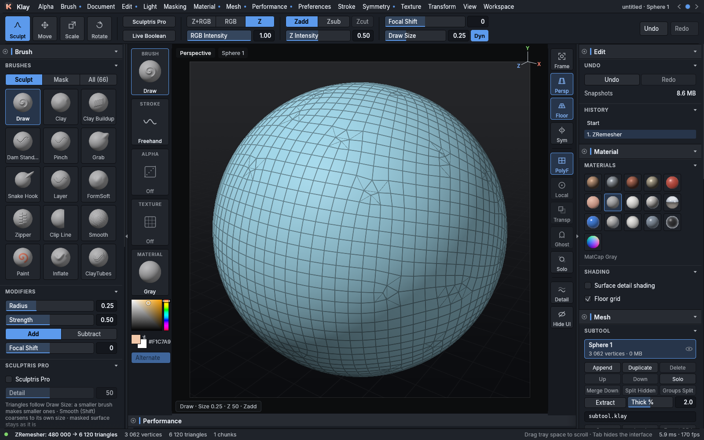
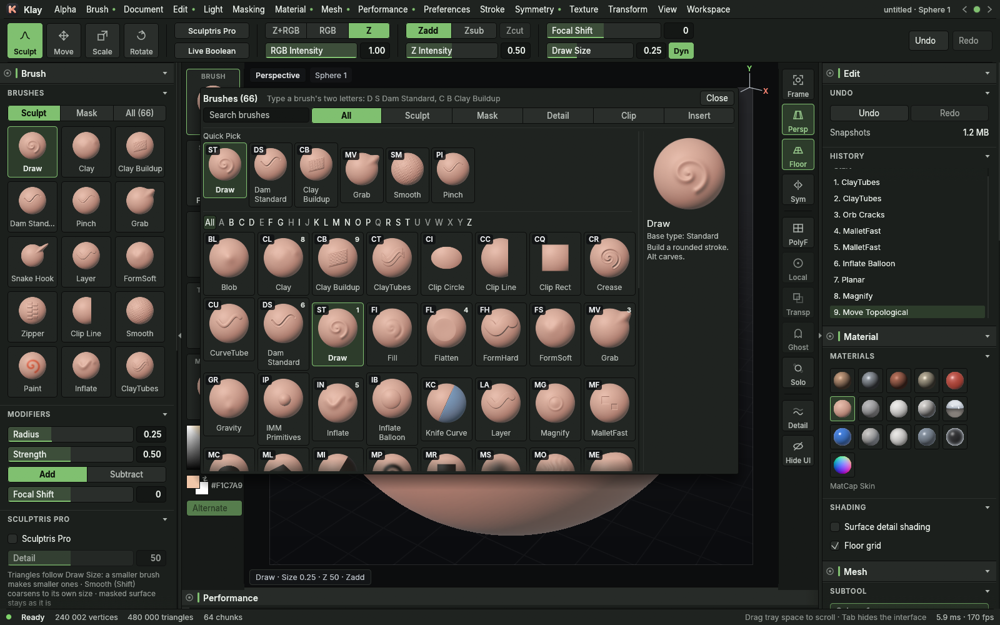
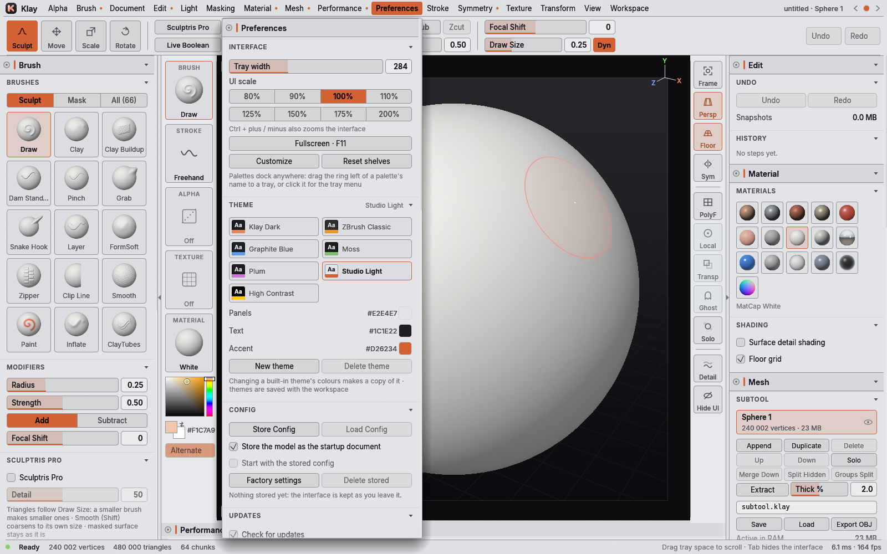

<p align="center">
  
</p>

<h1 align="center">Klay</h1>

<p align="center">Fast digital sculpting with a ZBrush-style workspace. Written in Rust.</p>



## Highlights

- **Millions of polygons**, subdivision levels and layers, on any Vulkan GPU
- **66 brushes**: Clay, Dam Standard, Move, Snake Hook, hPolish, Trim, Slash, Noise and more, picked ZBrush-style with **B** and two letters
- **Sculptris Pro**, **Live Boolean**, **ZRemesher**, **ZModeler**, Remesh, Insert Mesh and CurveTube
- **Select, Clip, Trim, Slice and Knife** tools, masking, polygroups and polypaint
- **Your workspace**: dock any palette, drag any shelf item anywhere, themes, UI scale, stored configs
- **Pen pressure** on Linux tablets, symmetry (mirror and radial), MatCaps

| | |
|---|---|
|  |  |
| ZRemesher: clean quads that follow the form | The brush catalog, ZBrush key codes on every tile |
|  | |
| Themes, UI scale and Customize in Preferences | |

## Install

Download the latest release from the [releases page](https://github.com/ozzy-apps/klay/releases):

| Format | Install |
|---|---|
| `.deb` (Ubuntu, Debian, Mint, Zorin) | `sudo apt install ./klay_<version>_amd64.deb` |
| Flatpak | `flatpak install --user Klay-<version>-x86_64.flatpak` |
| AppImage | `chmod +x Klay-<version>-x86_64.AppImage` and run it |

Klay checks for new releases while it runs (Preferences › Updates).

### Build from source

```bash
cargo run --release
```

Needs Rust 1.85+ and a Vulkan driver. `scripts/` builds the .deb, Flatpak and AppImage.

## Getting around

| | |
|---|---|
| Drag on the model | sculpt (Alt: the other way, Shift: smooth) |
| Drag on the canvas | rotate · Alt: move · Alt then release: zoom |
| Ctrl + drag | mask · Ctrl + Shift: hide, clip, trim, slice |
| B, two letters | pick a brush (B D S: Dam Standard) |
| Space | brush menu at the cursor |
| Q W E R | sculpt, move, scale, rotate |
| F · Tab · F11 | frame the model · hide the interface · fullscreen |

The full manual is in [docs/guide.md](docs/guide.md), and what changed in each version is in [CHANGELOG.md](CHANGELOG.md).

## Contact

Found a bug, or have a request? [Open an issue](https://github.com/ozzy-apps/klay/issues) or write to [klay@ozzy.co.nl](mailto:klay@ozzy.co.nl).

Made with love by Ozzy ♥ · [MIT License](LICENSE)


### Strata direct transfer (local source build)

With the sibling Strata project available, run `../Strata/run-klay.sh`. Under **3D Print > Strata**, use **Send to Strata** to transfer the active subtool (or check Visible subtools for an assembly), then **Update in Strata** after sculpting. Updates keep Studio position, rotation, scale and print settings. The first transfer uses the physical scale in 3D Print > Size; linked transfers retain it. Use the actual shown subdivision level and materialize Live Boolean results before sending.

Links currently last for a Klay document session; reopening requires Send again. No .klay format change was made. Dense meshes above the current 500,000 vertex/triangle bridge limit need a lower shown level. Existing running binaries must be reopened to show the actions. See `../Strata/handoff.md` for the protocol, verification and remaining work.
