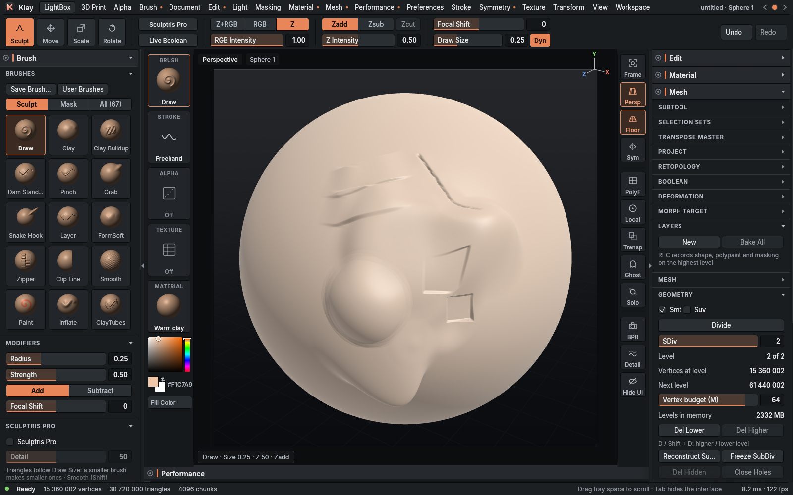
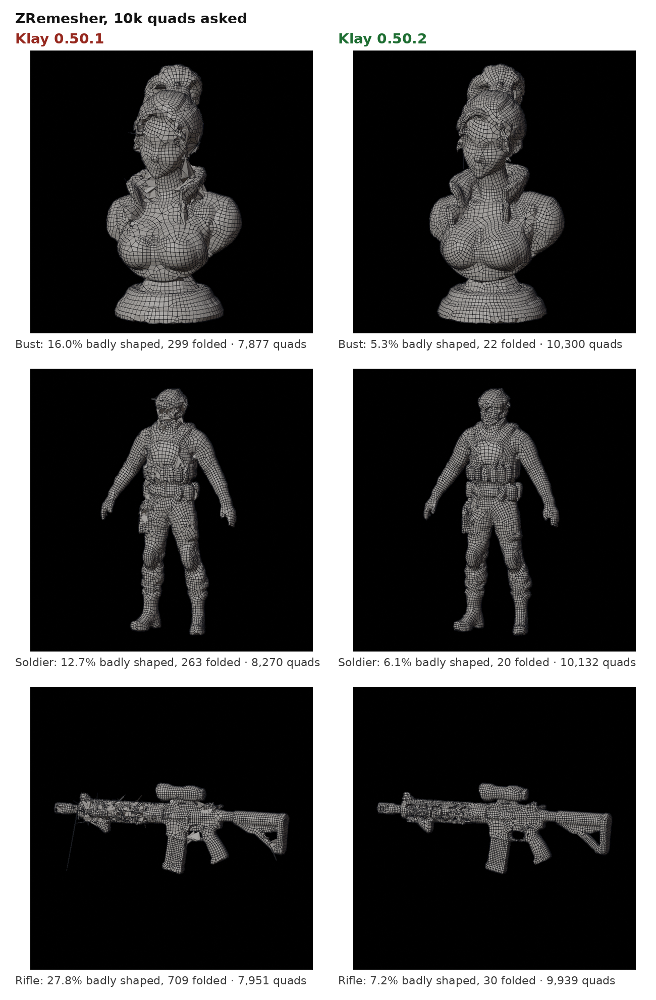
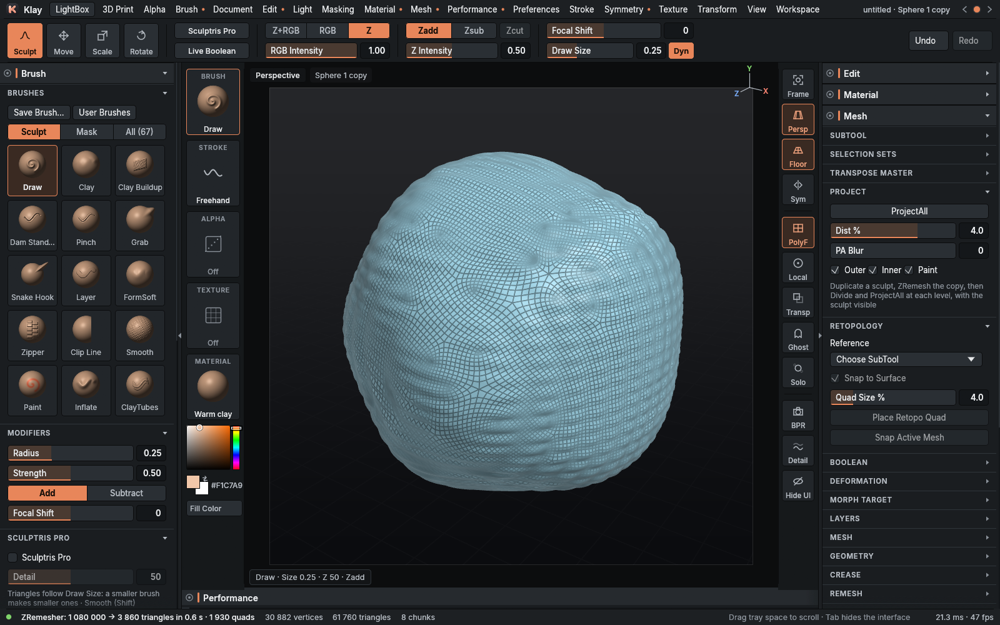
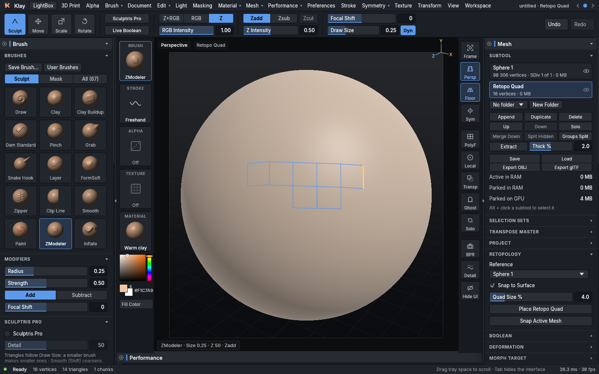
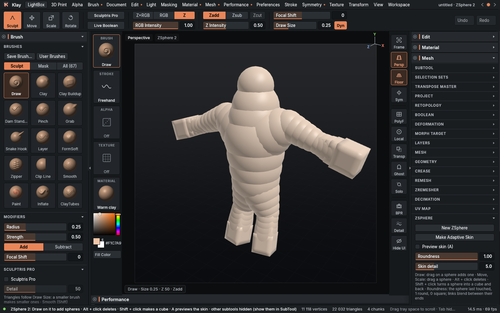
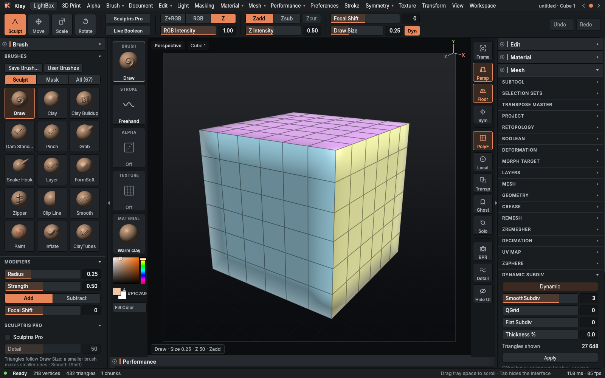
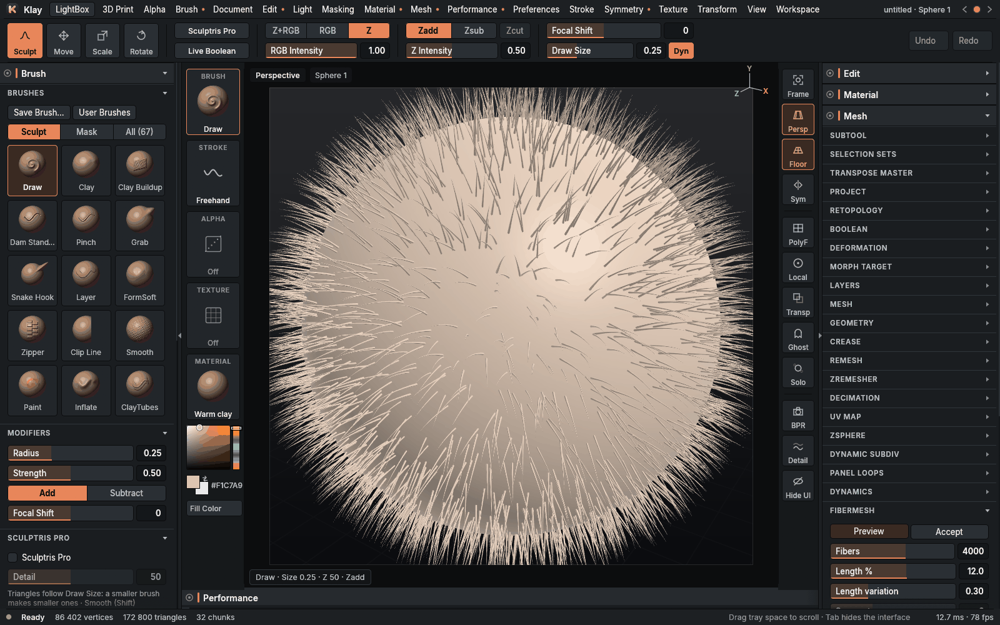
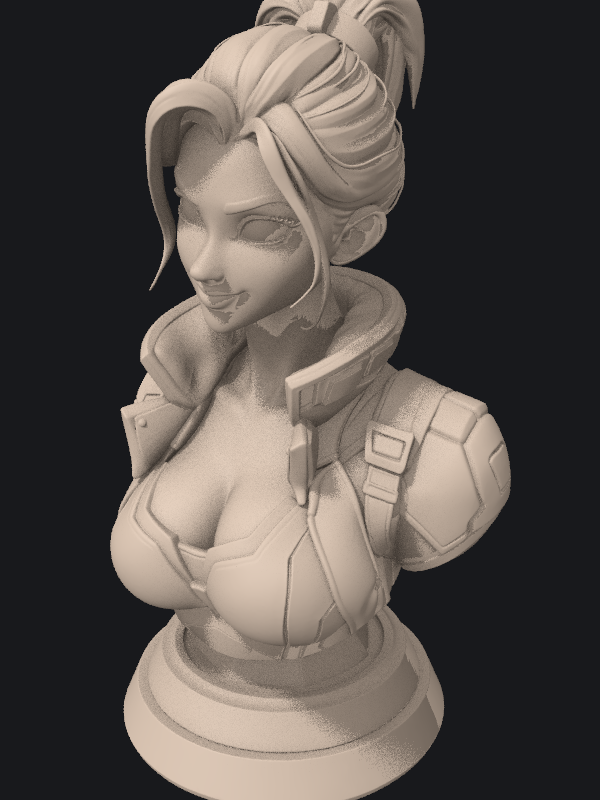
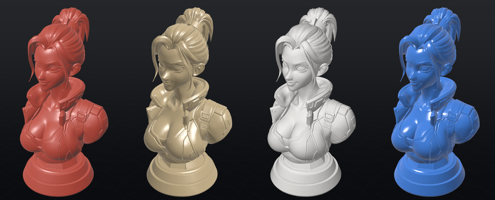

<p align="center">
  
</p>

<h1 align="center">Klay</h1>

<p align="center"><b>Sculpt millions of polygons in a ZBrush-style workspace. Free and open source.</b></p>

<p align="center">
  <a href="https://github.com/ozzy-apps/klay/releases">Download</a> ·
  <a href="docs/guide.md">Guide</a> ·
  <a href="CHANGELOG.md">Changelog</a>
</p>


## Why Klay

Klay is a digital sculpting app for characters, creatures and hard-surface parts. It follows
ZBrush's layout and key bindings, so ZBrush habits carry over: **B** and two letters pick a
brush, **Ctrl** masks, **Alt** reverses, and palettes dock wherever you want them.

It is written in Rust and draws on the GPU. Dense meshes stay responsive, and long
operations run in the background while you keep turning the view. Klay is free, MIT
licensed, and has no account or subscription.

## Sculpting and brushes


- **67 brushes**: Clay, Clay Buildup, Dam Standard, Move, Snake Hook, hPolish, Trim, Slash, Noise, Inflate and more.
- **ZBrush keys**: press **B**, then two letters (**B D S** for Dam Standard). Every tile shows its code.
- **Alphas and textures** with Wrap, so stamps follow the surface around edges and curves. Built-in detail patterns include skin, scales, cracks, panels and wood grain.
- **Pen pressure** on Linux tablets under X11 and Wayland, with curves per brush.
- **Symmetry**: X, Y and Z mirrors and radial symmetry.
- **Save brush presets** with their alphas and textures embedded, and load them again from LightBox.

## Millions of polygons



- **Subdivision levels** up to a 64-million-vertex budget. Step up and down with **D** and **Shift + D**.
- **Catmull–Clark** on quad cages, with creases that Divide keeps sharp.
- **Layers** record shape, polypaint and masks. Turn them up, down or off.
- **Reconstruct Subdiv** and **Freeze SubDiv Levels** for imported or retopologized meshes.
- **Sculptris Pro** adds triangles where the brush needs them.
- **4× anti-aliasing** and GPU culling keep dense meshes sharp and fast.

## ZRemesher and retopology




- **ZRemesher** turns any sculpt into clean quads, within a few percent of the count you ask for. Edge loops follow the form, even on noisy scanned or AI-generated models.
- **Plan Layout** (experimental) builds characters the way a box modeller would: a head on a neck, limbs as cylinders, face loops around the eyes, nose and mouth, and an exact mirror image.
- **Follow Shape** turns edge loops around limbs, ridges and hollows.
- **Detect Edges** lays one edge loop exactly on each hard edge, so hard-surface parts stay crisp.
- **Guides**: draw curves with the ZRemesherGuide brush (**B Z G**), and the loops follow them. Paint density with polypaint.
- **Symmetry** on X, Y or Z, and a wrapped retry for models with straps, pouches and other small gear.

| | |
|---|---|
|  |  |
| **ProjectAll** carries a sculpt's detail onto the new quads, level by level | **Manual retopology**: place quads and extrude edges that snap to the surface |

## Polypaint, UVs and map baking

| | |
|---|---|
|  |  |
| The **Space** menu: color, brush settings and quick brushes at the cursor | **UV Map**: unwrap, mark seams, pack islands, check with a checker |

- **Polypaint** in RGB or Z+RGB, with alphas, textures and **Fill Color**.
- **UV Master**-style unwrap with manual seams, island transforms and packing.
- **Bake** normal, displacement, vector displacement and color maps from the highest level onto the lowest.
- **Multi Map Exporter** bakes every visible SubTool in one background job.
- **Export glTF** with the baked normal and color maps embedded, ready for Blender, Godot, Unity and Unreal.

## Modelling tools

| | |
|---|---|
|  |  |
| **ZSpheres**: sketch an armature, with cube nodes, and skin it | **Dynamic Subdivision**: a smooth preview while you model the cage |

- **ZModeler**: QMesh, Extrude, Inset, Bevel, Bridge, edge loops, Crease, Slide, Stitch and more, on points, edges and polygons.
- **Live Boolean**: add, subtract and intersect SubTools and see the result live. Make Boolean Mesh bakes it.
- **Panel Loops**, **Decimation**, **Remesh**, **Insert Mesh**, **CurveTube**, **Close Holes** and **Mirror And Weld**.
- **Transpose**, **Gizmo 3D** and **Transpose Master** to pose and place parts.
- **Select, Clip, Trim, Slice and Knife** brushes, masking by cavity, smoothness and ambient occlusion, and polygroups.
- **FiberMesh** and cloth **Dynamics**.



## Rendering and materials

| | |
|---|---|
|  |  |
| **Render (BPR)**: ray traced shadows and ambient occlusion, saved as PNG | **16 materials and MatCaps**, plus your own MatCap images |

- **BPR** on the right shelf renders the view at once and saves it next to the project.
- **Turntable** saves a full turn as an MP4 with ffmpeg, or as PNG frames.
- **Light** palette for the key light, intensity and ambient.
- **Reference images** on a plane behind the model, and **Spotlight** to paint and sculpt through a picture.
- **Local**, **Transp** and **Ghost** views for working between SubTools.

## Your workspace


- **Dock any palette** to the left, right, top or bottom tray, or keep it in the menu bar.
- **Drag any shelf item** anywhere, and build your own shelf in Customize mode.
- **Seven themes** and your own colors, UI scale from 80 to 200 %.
- **Store Config** keeps your interface and, if you like, a startup model.
- **LightBox** (**,**) browses projects, tools, brushes, materials, alphas, textures and QuickSaves.

## Import and export


- **Import** OBJ, STL, GLB, glTF, FBX and ZBrush GoZ. Multipart scenes open as separate SubTools.
- **OBJ round trips** keep faces, UVs and named groups. **Update from OBJ** brings a revised cage back with its sculpted detail.
- **Export** OBJ, STL and glTF (`.glb`).
- **3D Print** palette: real-world size, Check Mesh, and Send to your slicer.
- **Projects** (`.klay`) save every SubTool with its levels, layers, polypaint, UVs and reference images.

## Download

Get the latest release from the [releases page](https://github.com/ozzy-apps/klay/releases):

| Platform | File | Install |
|---|---|---|
| Ubuntu, Debian, Mint, Zorin | `klay_<version>_amd64.deb` | `sudo apt install ./klay_<version>_amd64.deb` |
| Any Linux (Flatpak) | `Klay-<version>-x86_64.flatpak` | `flatpak install --user Klay-<version>-x86_64.flatpak` |
| Any Linux (AppImage) | `Klay-<version>-x86_64.AppImage` | `chmod +x Klay-<version>-x86_64.AppImage` and run it |
| Windows 10 and 11 | `Klay-<version>-x86_64-windows.zip` | Unzip and run `klay.exe` |

The Debian package and AppImage require glibc 2.39 or later. Klay checks for new releases while it runs (Preferences › Updates).

### System requirements

- 64-bit x86 Linux or Windows
- A GPU with a Vulkan driver (OpenGL is used where Vulkan is missing)
- RAM to match your meshes: each subdivision level costs about 140 bytes per vertex

## Getting around

| | |
|---|---|
| Drag on the model | sculpt (Alt: the other way, Shift: smooth) |
| Drag on the canvas | rotate · Alt: move · Alt then release: zoom |
| Ctrl + drag | mask · Ctrl + Shift: hide, clip, trim, slice |
| B, two letters | pick a brush (B D S: Dam Standard) |
| Brush › Save Brush… | save the current setup to LightBox › User › Brushes |
| `,` | toggle LightBox. Double-click a thumbnail to load it |
| Space | brush menu at the cursor |
| Q W E R | sculpt, move, scale, rotate |
| Shift + drag in Transpose | Snap the action line or lock Move to one axis |
| Y | Switch between Transpose and the Gizmo. Shift locks the Gizmo’s free-move handle to one of its axes |
| Shift + P | Toggle the floor grid at the lowest visible point |
| F · Tab · F11 | frame the model · hide the interface · fullscreen |

## Build from source

```bash
cargo run --release
```

Needs Rust, a C compiler for the FBX parser, and a Vulkan driver. `scripts/` builds the .deb, Flatpak and AppImage, and `scripts/package-windows.sh` cross-compiles the Windows zip (needs mingw-w64 and `rustup target add x86_64-pc-windows-gnu`).

## Documentation

The full manual is in [docs/guide.md](docs/guide.md), and what changed in each version is in [CHANGELOG.md](CHANGELOG.md).

## Contact

Found a bug, or have a request? [Open an issue](https://github.com/ozzy-apps/klay/issues) or write to [klay@ozzy.co.nl](mailto:klay@ozzy.co.nl).

Made with love by Ozzy ♥ · [MIT License](LICENSE)

## For developers

### Strata direct transfer (local source build)

Built only with `cargo build --release --features strata`; default builds and the release packages leave it out. With the sibling Strata project available, `../Strata/run-klay.sh` builds both and starts Klay with it. Under **3D Print > Strata**, use **Send to Strata** to transfer the active subtool (or check Visible subtools for an assembly), then **Update in Strata** after sculpting. Updates keep Studio position, rotation, scale and print settings. The first transfer uses the physical scale in 3D Print > Size; linked transfers retain it. Use the actual shown subdivision level and materialize Live Boolean results before sending.

Links currently last for a Klay document session; reopening requires Send again. No .klay format change was made. Dense meshes above the current 500,000 vertex/triangle bridge limit need a lower shown level. Existing running binaries must be reopened to show the actions. See `../Strata/handoff.md` for the protocol, verification and remaining work.
